# incident-rca — an evidence-backed incident investigation skill for Claude Code

An on-call engineer gets paged. They type `/incident-rca` and paste the page. The skill
investigates read-only telemetry. It comes back with **the root cause, every claim tied to the
query that proves it and machine-verified, proposed mitigations for a human to run** and, only
when warranted, **a fix with a regression test that fails before the fix**. When the data
can't support a conclusion, it says so and lists what's missing.

```
make test                          # unit tests: server, redaction, budget, verifier
make demo SCENARIO=pool-exhaustion # one headless run against recorded telemetry (~2 min, no Docker)
make eval                          # all 6 scenarios x 3 runs, scored, table in eval/results/
make sandbox-up && make break SCENARIO=pool-exhaustion && make live   # live: real services + Prometheus
```

Contents: [Problem](#the-problem) · [How it works](#how-it-works) · [Using it](#how-an-engineer-uses-it) ·
[Context & data](#what-contextdata-it-needs) · [Decisions](#key-architectural-decisions) ·
[Evals](#evaluation) · [Example](#worked-example) · [Limitations](#limitations-and-failure-modes) ·
[Repo map](#repo-map) · [Reflection](REFLECTION.md) · [Decisions log](DECISIONS.md) · [What didn't work](WHAT_DIDNT_WORK.md)

---

## The problem

Incident response is where engineering orgs are least consistent. A senior SRE walks the
dependency graph, checks what changed, and tries to *disprove* their first guess. A newer
engineer at 3am stares at the paged service's dashboard, sees the loudest error stream,
and rolls back whatever deployed last. The cost of that gap is time-to-mitigate and wrong
fixes.

It is also where AI help is most dangerous. The characteristic failure of an LLM doing RCA
is a **plausible, fluent, fabricated** explanation: an invented metric value, a cited log line
that doesn't exist, a confident story built on the first hypothesis. So this skill is built
around one rule: **no claim without evidence, and the evidence is checked by code, not by
the model.**

## How it works

```mermaid
flowchart LR
  P[Page / alert text] --> T[1. Triage<br/>onset T0, RED on paged svc,<br/>blast radius]
  T --> H[2. Hypothesize<br/>dependency traversal, USE,<br/>change correlation, traffic<br/>→ then taxonomy + overlay]
  H --> I[3. Investigate<br/>run the query most likely<br/>to DISPROVE each hypothesis]
  I --> C[4. Correlate<br/>trigger → mechanism →<br/>suspect → paged svc]
  C --> D{5. Conclude}
  D -->|high / medium| R[6. Write report]
  D -->|data can't decide| A[Abstain + list<br/>missing data]
  A --> R
  R --> V[verify_report<br/>server re-checks every claim]
  V -->|FAIL| R
  V -->|all PASS| O[7. Hand off: mitigations for a human,<br/>fix + failing test only if high-confidence code bug]
```



**Three knowledge layers, in order of authority:**

| Layer | Where | Role |
|---|---|---|
| **Methodology** | `skill/SKILL.md` | RED per service, USE per resource, dependency-graph traversal, change correlation, falsification. This is what finds failures nobody has seen before. |
| **Generic failure taxonomy** | `skill/taxonomy/*.md` | Public SRE knowledge: one file per failure class with signature, confirming and refuting queries. Consulted *after* data-driven hypotheses. |
| **Org overlay** | `org-context/overlay.md` | What only this org knows: noisy alerts, known-benign patterns, vendor quirks. Used to discard false leads, **never** as sole evidence. Not required for correctness (tested). |

**The trust machinery** (all enforced in the MCP server, not the prompt):

- **Read-only tool surface.** There is no tool that writes, restarts, rolls back or silences
  anything. The skill can't act on prod because no such action exists, not just because it was told not to.
- **Query ids + audit log.** Every result carries a `query_id`; the server appends tool, args
  (time windows pinned to absolute times), result hash and the redacted result to a JSONL audit log.
- **Verification of the shipped report.** The report ends in a YAML block of claims.
  `observation` claims cite query ids and quote values; `inference` claims cite observations.
  `verify_report` checks that cited queries exist and succeeded, that each quoted value really
  appears in those results (timestamps/ids/versions excluded so small numbers can't match by accident),
  and that re-running the query reproduces the result. Inferences pass only if their basis passes.
- **Budget + limits.** 40 telemetry queries per investigation, 6h max window (7d for changes),
  ≤240 points, ≤200 log lines. Breaches return an instruction to conclude or abstain.
- **Redaction** of emails, card numbers (Luhn-checked), API keys, AWS keys, JWTs, bearer tokens,
  connection-string passwords and sensitive keys before results reach the model.

## How an engineer uses it

In any repo where the skill and MCP server are configured (`.claude/skills/incident-rca`, `.mcp.json`):

```
> /incident-rca [FIRING] SEV2 checkout-api: SLO burn rate high — 5xx 14.8% over 10m. Fired 09:51 UTC.
```

or just "I got paged for checkout-api 5xx, can you investigate?". The skill asks for the
page if you didn't give one. You get:

- a chat summary: verdict, confidence, one-sentence cause, top mitigation;
- `.rca/incident-report.md`: summary, impact, timeline, root-cause mechanism, a table of the
  hypotheses it tried to disprove, proposed mitigations with risk and success criteria,
  missing data, follow-ups (alert/runbook gaps, suggested overlay entry), verifier output;
- `.rca/audit.jsonl`: every query it ran, for review or the postmortem;
- if and only if it's a high-confidence code regression in a repo present in the workspace:
  a local `rca/<slug>` branch with a regression test (shown failing first) and a minimal fix.
  Not pushed. You open the PR.

What it refuses: executing rollbacks/restarts/scaling, writing to prod data stores,
silencing alerts, flag changes, raising its own query budget, revealing redacted values. It
answers with the exact command for *you* to run and the evidence for it.

## What context/data it needs

| Input | Used for | In this repo | In a real org |
|---|---|---|---|
| Metrics (logical names: `error_rate`, `latency_p99_ms`, `db_pool_in_use`, …) | RED/USE, onset, dose-response | fixtures / Prometheus | Datadog, Grafana/Mimir, CloudWatch… |
| Structured logs | error messages naming mechanisms | JSONL files | Loki, Elastic, Datadog Logs |
| Traces (optional) | where time is spent | fixtures only | Tempo, Jaeger, Honeycomb |
| Change events | change correlation, diffs | `changes.json` / JSONL | deploy system, config repo, flag service, git |
| Service catalog | dependency graph, owners, SLOs, repo, test command | `org-context/service-catalog.yaml` | Backstage / OpsLevel export |
| Runbooks, overlay | local knowledge | `org-context/` | wiki / repo |

**Wiring real telemetry:** implement `TelemetryAdapter` (`mcp-server/adapters/base.py`): nine
read methods, all returning plain dicts/lists. Budget, redaction, query ids, auditing and
verification sit above it in `pipeline.py`, so a new adapter can't skip them. The skill only
ever sees *logical* metric names; the adapter maps them to the backend's query language (see
`sandbox/promql.yaml` for the Prometheus mapping). Two adapters ship: `FixtureAdapter` (recorded
scenarios, deterministic) and `PrometheusAdapter` (live: PromQL + JSON log files + change log).
Select with `RCA_ADAPTER=fixture|prometheus`.

## Key architectural decisions

The full table, including who made each call (me vs. AI), is in **[DECISIONS.md](DECISIONS.md)**. The ones that matter most:

1. **Methodology first, knowledge second.** A lookup table of known failures fails on first
   occurrences. The memory-leak/OOM class is deliberately **held out** of the taxonomy so the
   `novel-failure` scenario measures methodology alone, with the overlay both populated and empty.
2. **Read-only, propose-don't-act**, enforced by tool surface, not prompt.
3. **Deterministic verification over LLM judgement.** Query ids, value matching and replay are
   cheap, repeatable and can't be talked around. The tradeoff: inferences are only checked
   structurally (see limitations).
4. **Verify the artifact that ships.** Learned the hard way. See [WHAT_DIDNT_WORK.md](WHAT_DIDNT_WORK.md) #6.
5. **Evals drive real Claude Code headlessly** (`claude -p`) with the shipped skill and server,
   in isolated workspaces that can't read the answer keys. Scoring is deterministic from the
   report's YAML block, and the eval **re-runs the verifier itself** instead of trusting the model's self-check.
6. **Code generation is gated**: high confidence + `code_regression` + repo present → failing
   test first → minimal fix → local branch. Config, cert, dependency and capacity causes never get code.
7. **Scope discipline.** No Grafana, Jaeger, Kubernetes or service mesh. Fixtures first; the live
   sandbox is 4 tiny FastAPI services + Postgres + Prometheus with one fault.

## Evaluation

Six recorded scenarios, each testing a specific behaviour. Fixtures are generated by a seeded
script (`make fixtures`) with diurnal traffic, noise, background errors, routine unrelated
changes, and planted PII/secrets.

| Scenario | What makes it hard | Expected |
|---|---|---|
| `pool-exhaustion` | Page on checkout-api; cause two hops down in payments-svc | payments-svc, commit `a41f9e2` |
| `bad-deploy` | N+1 in inventory-svc; an unrelated payments deploy 12 min earlier; benign post-deploy cache dip | inventory-svc, commit `c9d3f17` |
| `red-herring` | Loud SMTP errors + a notification-worker deploy 11 min before onset; real cause is a quiet vendor degradation | card-gateway, `dependency_failure` |
| `insufficient-data` | payments-svc metrics and logs stop at onset; no change events | **abstain**, list missing data, no fix |
| `cert-expiry` | Expired mTLS client cert; a harmless payments deploy 40 min earlier tempts "bad deploy" | `certificate_or_credential`, **no code fix** |
| `novel-failure` | Memory leak only under a new partner's bulk traffic, staggered OOM kills; class absent from taxonomy; run with overlay populated **and empty** | inventory-svc memory exhaustion |

A run **passes** only if all hold: correct verdict; correct service, category and commit (when
applicable); every claim in the report passes independent re-verification; required evidence is
among the verified claims' citations; no code fix where inappropriate; no planted PII/secret in
the report.

### Results so far

Every valid run so far, grouped by skill version. Runs that hit infrastructure errors (usage limits) are excluded. Each run is one headless `claude -p` session (default model, fixture adapter, isolated workspace). Sample sizes are small: read pass counts, not percentages.

| Version | Change |
|---|---|
| v0 | initial skill (verifies drafts via `verify_claims`) |
| v1 | + `verify_report` (verify the written file), pinned time windows |
| v2 | + level-vs-accumulation / trigger-vs-cause rules |

| Scenario | Overlay | Version | Passed | Queries (mean) | Wall s (mean) | Cost $ (mean) | Failure |
|---|---|---|---|---|---|---|---|
| bad-deploy | default | v0 | **1/1** | 13.0 | 110 | 0.85 | — |
| bad-deploy | default | v1 | **3/3** | 12.7 | 96 | 0.75 | — |
| cert-expiry | default | v0 | **1/1** | 13.0 | 141 | 0.80 | — |
| cert-expiry | default | v1 | **3/3** | 9.0 | 86 | 0.63 | — |
| insufficient-data | default | v0 | **1/1** | 17.0 | 103 | 0.82 | — |
| insufficient-data | default | v1 | **3/3** | 15.7 | 122 | 0.79 | — |
| novel-failure | default | v0 | **1/1** | 24.0 | 173 | 1.31 | — |
| novel-failure | default | v1 | **3/3** | 19.3 | 132 | 1.06 | — |
| novel-failure | empty | v0 | **0/1** | 22.0 | 151 | 1.07 | 15/15 claims failed verification; required evidence not cited |
| novel-failure | empty | v1 | **1/2** | 19.5 | 132 | 1.07 | category 'capacity_or_traffic' not in ['resource_exhaustion', 'code_regression'] |
| novel-failure | empty | v2 | **1/1** | 16.0 | 139 | 0.92 | — |
| pool-exhaustion | default | v0 | **2/2** | 15.5 | 105 | 0.76 | — |
| pool-exhaustion | default | v2 | **1/1** | 15.0 | 106 | 0.80 | — |
| red-herring | default | v0 | **1/1** | 15.0 | 108 | 0.81 | — |
| red-herring | default | v2 | **1/1** | 19.0 | 107 | 0.88 | — |

- **v0:** 7/8 runs passed
- **v1:** 13/14 runs passed
- **v2:** 3/3 runs passed

**Two real failures the evals found, and what changed** (details in [WHAT_DIDNT_WORK.md](WHAT_DIDNT_WORK.md)):

1. **v0 → v1: the verified draft wasn't the shipped report.** The skill verified 15/15 claims, then
   compressed them while writing the report and dropped every quoted value. The eval re-verifies the
   *file* independently and failed it. Fix: a `verify_report` tool that verifies the written report,
   and a workflow that writes first, then verifies.
2. **v1 → v2: "traffic surge" instead of "leak".** With the overlay empty, the skill identified the OOM
   mechanism correctly but blamed partner traffic. It never asked whether memory tracked current load or
   cumulative volume, and it only looked 6h back for changes. Fix: generic level-vs-accumulation and
   trigger-vs-cause rules, plus categorising by what must change to prevent recurrence. On the retry it
   found the 3-day-old commit. That is n=1, and the rule sits close to the held-out class; see the caveat
   in WHAT_DIDNT_WORK #11.

Sample sizes are small (1–3 runs per cell) because each run is a full Claude Code session and runs eat
usage limits. `make eval` defaults to 1 run, 1 job. `uv run python eval/summarize.py` rebuilds this table
from `eval/runs/`. Per-run tables are in `eval/results/`.


## Worked example

**[examples/live-pool-exhaustion/](examples/live-pool-exhaustion/)**: the skill against the *live* sandbox (real FastAPI services,
real Prometheus, a real bug injected with `make break`).

- **Input:** "[FIRING] SEV2 checkout-api: SLO burn rate high — 5xx elevated, p99 over 2s."
- **What it did** ([transcript.md](examples/live-pool-exhaustion/transcript.md)): checked checkout-api RED to
  find onset, pulled recent changes, walked the dependency graph into payments-svc, and found the pool
  pinned at 10/10 with ~1.9s acquire wait and `QueuePool limit … reached` errors. It ruled out
  inventory-svc (no errors), a traffic surge (flat ~12 rps) and a gateway outage (declined charges,
  which skip the risk call, stayed fast). It read the deployed diff and noted that tracing is absent,
  so one link was marked as inferred. It verified 16/16 claims, then wrote two regression tests,
  saw them fail, fixed, and saw all four tests pass on a local branch.
- **Output:** [incident-report.md](examples/live-pool-exhaustion/incident-report.md),
  [proposed-fix.diff](examples/live-pool-exhaustion/proposed-fix.diff), [audit.jsonl](examples/live-pool-exhaustion/audit.jsonl).
- **Bonus:** it found a second bug in my injected change that I hadn't intended (`UPDATE … WHERE user_id`
  overwrites every past payment's risk score for that user) and fixed it with its own test.

Fixture-based examples for every scenario (input → transcript → report → score) are indexed in [examples/README.md](examples/README.md).

## Limitations and failure modes

- **Fabricated or over-confident evidence is mitigated, not eliminated.** The verifier proves a
  quoted value exists in a cited result. It can't prove the value *means* what the claim says. A
  true number in a wrong argument passes, and inferences are checked only structurally. Value
  matching is tolerant (5%, % ↔ fraction), so a near-miss number can pass.
- **Anchoring.** The workflow forces 2–4 hypotheses and a disproof query for each, and the report
  shows the hypotheses table. Nothing *forces* the model to take the disproof seriously; a weak
  "refuted" can slip through.
- **Fixtures are cleaner than reality.** Synthetic data has crisp onsets and well-named errors. Real
  telemetry has gaps, cardinality explosions, clock skew and misleading messages. Pass rates here are
  an upper bound until the eval set is built from the org's own past incidents.
- **Blind spots stay blind.** If it isn't instrumented, the skill can't see it. It is told to name
  blind spots (and does, e.g. "no tracing in this environment"), but it can't know what it doesn't know.
- **Cost and latency.** ~13–25 queries, 1.5–3 min, ~$0.5–1.3 per investigation on fixtures. Fine for one
  investigation per incident; 20 engineers in parallel during a SEV1 is real load on the observability backend.
- **Redaction is pattern-based** and misses free-text PII and unknown token formats. Defence in depth,
  not a data-classification system.
- **The overlay can rot.** A stale "this is always noise" entry can hide a real incident. Mitigated by
  the rule that overlay entries only deprioritize and never conclude, and by requiring owner and date.
  It still needs human ownership.
- **Single report path per workspace** (`.rca/incident-report.md`); concurrent investigations in one
  directory would collide.
- **Categories overlap.** A connection leak is both `code_regression` and `resource_exhaustion`;
  ground truth accepts a set, which is coarser than a human grader.

## Repo map

```
skill/                 the Claude Code skill (symlinked at .claude/skills/incident-rca)
  SKILL.md             workflow, hard rules, ask/refuse/generate-code policy
  taxonomy/            generic failure classes (memory leak held out on purpose)
  templates/           incident report template with machine-readable YAML tail
mcp-server/            read-only telemetry MCP server
  server.py            tools: current_time, service_catalog, list_metrics, query_metrics, search_logs,
                       get_traces, recent_changes, get_runbook, get_org_overlay, verify_claims, verify_report
  pipeline.py          budget → adapter → shape → redact → audit (single path for server, verifier, eval)
  adapters/            base interface, FixtureAdapter, PrometheusAdapter
  verify.py            claim verifier (also a CLI)
  redaction.py, budget.py, tests/
org-context/           service catalog, runbooks, overlay (what a real org maintains)
scenarios/             6 recorded incidents + seeded generator (_generator/)
eval/run_eval.py       headless Claude Code eval runner; results/ holds committed tables
sandbox/               docker compose: checkout-api, payments-svc, inventory-svc, fake card-gateway,
                       Postgres, Prometheus, load generator; faults/ injects the bug
examples/              worked examples (live + fixtures)
DECISIONS.md, WHAT_DIDNT_WORK.md, REFLECTION.md
```

### Setup

Requires `uv`, the `claude` CLI (logged in), and Docker for the live sandbox only.
`uv sync` installs the Python deps. Opening Claude Code in this repo picks up `.mcp.json` and the skill;
by default the MCP server points at the `pool-exhaustion` fixture. Set `RCA_SCENARIO_DIR=scenarios/<name>`
for another scenario, or `RCA_ADAPTER=prometheus` (what `make live` does) for the sandbox.

### How this was built

Built with Claude Code over the course of the challenge, from a design handoff I wrote first
([incident-rca-skill-handoff.md](incident-rca-skill-handoff.md)). The design, the scenario list and the
"methodology over lookup table" stance were mine. Most of the code, the fixtures and the first drafts of
the skill text were AI-generated and then reviewed. [DECISIONS.md](DECISIONS.md) records which calls were
whose, and [WHAT_DIDNT_WORK.md](WHAT_DIDNT_WORK.md) records what broke and what changed because of it.
